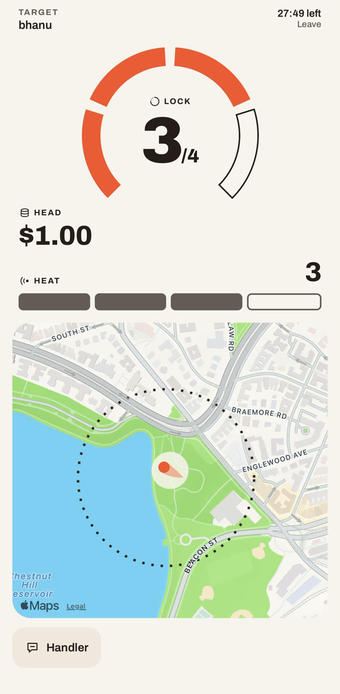
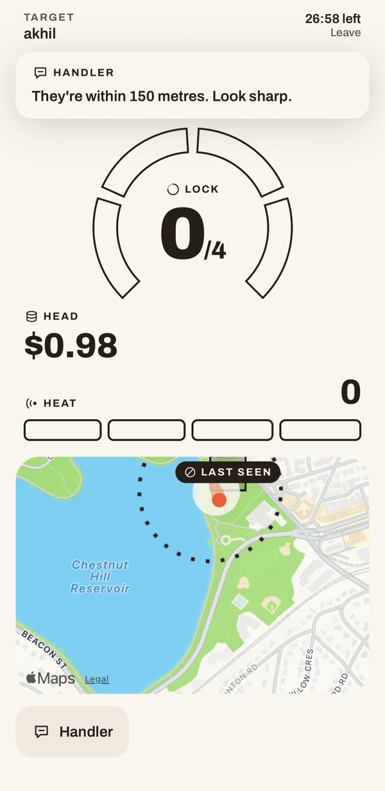
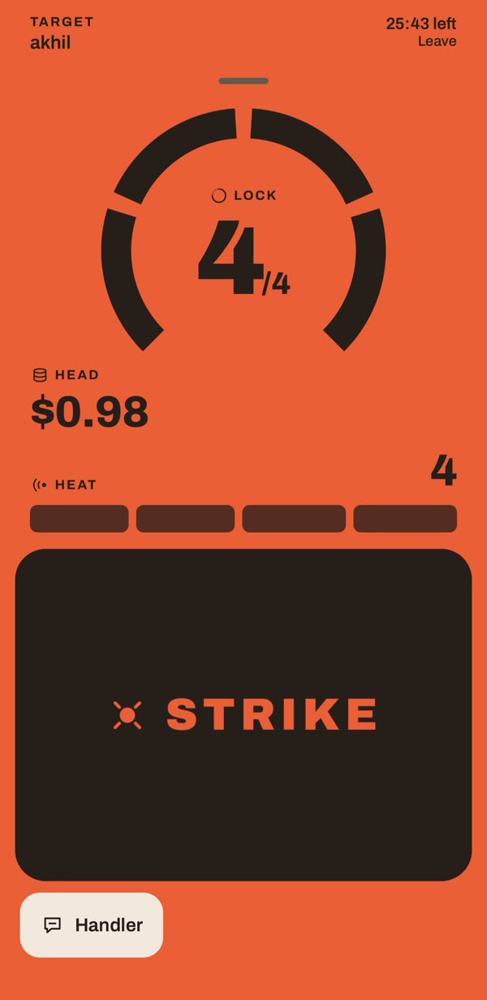
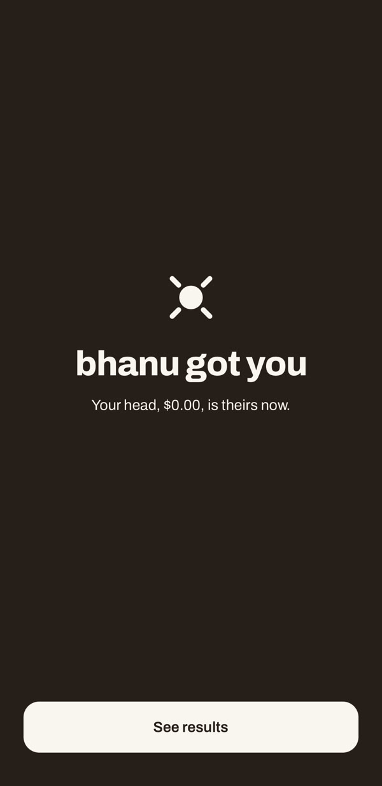
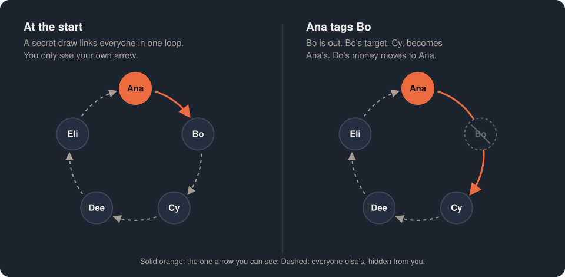
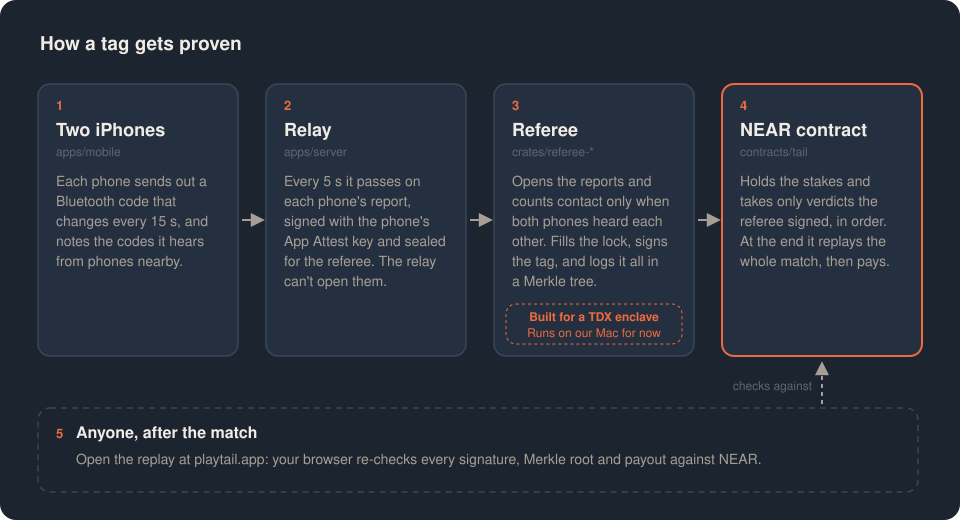

# TAIL

**An iPhone game of tag for 3 to 12 friends in a real park. You can only tag someone your phone
can actually hear.**

Everyone puts the same stake on their own head and gets one secret target, and someone else has
you. Get close to your target and stay close, and their money is yours. Faking your GPS won't
help: a tag only counts when both phones picked each other up over Bluetooth. A contract on NEAR
holds the stakes and replays the whole match before it pays anyone.

<table>
  <tr>
    <td width="25%"></td>
    <td width="25%"></td>
    <td width="25%"></td>
    <td width="25%"></td>
  </tr>
  <tr>
    <td align="center">Closing in: the lock fills while both phones hear each other</td>
    <td align="center">A hint from the Handler</td>
    <td align="center">Lock full: strike</td>
    <td align="center">And when someone gets you</td>
  </tr>
</table>

<sub>From two phones during the real match at Chestnut Hill Reservoir, 2026-11-14.</sub>

After the match, anyone can replay it in a browser and check it against NEAR:


[Watch a real match](https://playtail.app/?match=c043db6be8eedceaf6194989e59b47e6) ·
[playtail.app](https://playtail.app) · [How to play](https://playtail.app/docs) ·
Built for the NEAR Hackathon. Runs on NEAR testnet with test USDC.

## Why we made it

Location games believe whatever position the phone reports. Anyone with a GPS spoofer can win from
their couch, and once there's money on the line, nobody wants to play a game that's that easy to
cheat.

So we built one where you have to be standing next to someone to tag them, and where every tag
leaves evidence anyone can check afterwards.

## How a match plays

1. A host picks the stake, the length and a play area around them. Friends scan a QR code or type
   a short code to join.
2. At the start, a secret draw puts everyone in one loop of hunters and targets. You see only your
   own target.
3. Your **lock** fills while your phone and your target's phone keep hearing each other. When it's
   full, **strike**: your target is out, and their money and their target become yours.
4. Someone is doing the same to you. Your **heat** rises as their lock on you fills, but you never
   find out who it is.
5. Stuck? Buy a hint from **the Handler**, an AI voice that tells you if you're close and which way
   to go. Hints cost more when lots of people are buying them, and the money goes to the player
   you asked about.
6. Close the app and you go dark: your hunter sees a 100 m square around you. Three minutes dark in
   total and you forfeit.
7. When time runs out, everyone still standing keeps their head.

<p align="center">
  
</p>

## How a tag gets proven

<p align="center">
  
</p>

Each phone broadcasts a 16-byte code that changes every 15 seconds and that only the referee can
read, and it writes down every code it hears. A 15-second window counts as contact only when both
phones heard each other above −82 dBm and their GPS fixes are within 40 m of each other (plus the
fixes' accuracy). Four contact windows out of the last eight fill the lock.

Every report is signed with the phone's Apple App Attest key, so it has to come from our app on a
real iPhone. Simulated locations are refused, and so is moving faster than 15 m/s. The relay that
carries the reports can't open them; they're sealed to the referee's key, which each phone checks
against the key stored on NEAR.

The referee writes every report, contact and verdict into a Merkle log. Once a minute the log's
root goes on NEAR with a proof that the new log extends the old one, so nothing already written
can be changed later. At the end, the contract rebuilds the loop of targets and replays every hint
price, tag and forfeit. If any rule was broken, everyone gets their stake back. The same happens
if the referee goes silent for 15 minutes.

**One honest caveat.** The referee is built to run inside an Intel TDX enclave on OutLayer, where
nobody, including us, could sign a fake verdict. That build is deployed, but OutLayer's testnet
has been taking 80 to 90 seconds per call and our referee ticks every 10 seconds, so it has never
completed a match. For now the contract trusts the same referee code running on our Mac, and the
replay labels it `Test referee`. Everything it decided can be re-run and checked after the match,
but during play you are trusting us.

## Where NEAR comes in

- **The contract holds the money.** Stakes are test USDC on `tail.tail-dev-a38d13.testnet`. It
  accepts only verdicts signed by the referee, in order, and replays the whole match before
  paying out.
- **Players never touch the chain.** The phone makes its own key. The relay creates a NEAR account
  for each player, holding a key that can only join, leave and withdraw, and pays the gas. No seed
  phrase and no signing pop-ups; the only chain step a player sees is naming a wallet the first
  time they withdraw.
- **The Handler runs on NEAR AI Cloud.** Its lines come from an open-weight model, and the replay
  checks NEAR AI's Intel TDX attestation of the key that signed each line. That shows the key lives
  on a real TDX machine. It doesn't show which code that machine runs.
- **Your record is an NFT you can't sell.** Each player gets a soulbound Dossier (NEP-171). The
  contract writes every settled match into it and draws the card itself. A host can open a match
  only to players with a record.
- **Presence proofs.** Any contact the referee logged can be shared as a small proof that two
  players were near each other, and anyone can check it against the contract with no account.

## Try it

### In a browser, nothing to install

| Open                                                                                                                                                                                                                                                                                                                                                                                                                                                                                                                                                                                                                                                                                                                                                                                                                                                                                                                                                                                                                                                                                                                                        | What you'll see                                                                                                                                                                                                                                                      |
| ------------------------------------------------------------------------------------------------------------------------------------------------------------------------------------------------------------------------------------------------------------------------------------------------------------------------------------------------------------------------------------------------------------------------------------------------------------------------------------------------------------------------------------------------------------------------------------------------------------------------------------------------------------------------------------------------------------------------------------------------------------------------------------------------------------------------------------------------------------------------------------------------------------------------------------------------------------------------------------------------------------------------------------------------------------------------------------------------------------------------------------------- | -------------------------------------------------------------------------------------------------------------------------------------------------------------------------------------------------------------------------------------------------------------------- |
| [The real match](https://playtail.app/?match=c043db6be8eedceaf6194989e59b47e6)                                                                                                                                                                                                                                                                                                                                                                                                                                                                                                                                                                                                                                                                                                                                                                                                                                                                                                                                                                                                                                                              | Four of us played it on iPhones at Chestnut Hill Reservoir on 2026-11-14: three tags, three hints, one survivor. Your browser re-checks every signature, Merkle root and payout and ends on `All 15 verdicts match NEAR`. Click a hint to see NEAR AI's attestation. |
| [A presence proof from that match](https://playtail.app/?presence=eyJ0eXBlIjoidGFpbC9wcmVzZW5jZS1wcm9vZiIsIm1hdGNoSWQiOiJjMDQzZGI2YmU4ZWVkY2VhZjYxOTQ5ODllNTliNDdlNiIsImNvbnRyYWN0IjoidGFpbC50YWlsLWRldi1hMzhkMTMudGVzdG5ldCIsImNvbnRhY3QiOnsiYSI6MSwiYiI6MiwiZXBvY2giOjE3LCJzYWx0IjoiNTNjZDRjMmVmYmU4ZTBlZjk2YzljYmUwNDU4MWJjZmUifSwiaW5kZXgiOiIyNzUiLCJzaXplIjoiMzExIiwicGF0aCI6WyIwN2QzNjExNGY0MThkNTBkNzYzZmY5ZTkyODgwMmUyMzUxNTY5MGVjZWVlMTQ2ZmRlN2E1NTQyZGUyMzg0ZGQwIiwiNjI5OWNmNzJkYTY3Njc4OWE4NzE2N2Q5NmE3NDQxMTA4MzJmMzc3ZTJlYmQ0ZDZjMGYyMzBlZDJkYzA4ZGYxZCIsIjdiMjBkNzdlZDdkZWZhMjM3ZWJkOGExM2Q4YTgzNDdjMWMyNWVlMmM1NDA3ZWYxNTg0NzQ2NGUyMzEwN2MwZTAiLCJmOGRjMzUxN2UyMDY2MTI1ZGVlMzZmMGFjOWE2MTg2Yjk0MzA3MzkxM2UyZjNhM2JkOWY0MTQ4YjE3ZWY0OWE2IiwiMTA0ZGVmOGZjZGQ2ZDIzYTUxMTZhZjE4MjhlOTI1ODU1N2M1NzhhNDllNjc0MjJiMWNlNzMwYzdlYjFjMWEwMiIsIjNlZDZkMGMxYWY2MWY0MDI4YWZlMTJkZTYxMDM0M2RiMWU2ODhjZWIxM2M1NTM4NmFmZmNiY2VlNjBjNzgxYzQiLCI4MDk3Y2Y3NTU1YmE4ZmJlODFlNzVkZDFhODFhYjgyZmZmOTBiMDUwYjJiMTdlNWJhNGUxZmE2NDRmOWFjZDZlIl0sImFjY291bnRzIjpbImJoYW51LnRhaWwtZGV2LWEzOGQxMy50ZXN0bmV0IiwiYm9nLnRhaWwtZGV2LWEzOGQxMy50ZXN0bmV0Il19) | `The referee logged Bhanu and Bog near each other` and `Matches NEAR`: one logged contact and its path to the root the contract stored.                                                                                                                              |
| [A generated match on Boston Common](https://playtail.app/?fixture=boston-common)                                                                                                                                                                                                                                                                                                                                                                                                                                                                                                                                                                                                                                                                                                                                                                                                                                                                                                                                                                                                                                                           | Five players on a 3D map. It's signed with public test keys and never sent to NEAR, so after about 15 s of checks it reads `Not on NEAR`. Pause, then click a tag on the timeline to see its evidence.                                                               |
| [The same match with a forged tag](https://playtail.app/?fixture=boston-common-tampered)                                                                                                                                                                                                                                                                                                                                                                                                                                                                                                                                                                                                                                                                                                                                                                                                                                                                                                                                                                                                                                                    | One tag was rewritten after it was signed. The header reads `Verdict history is broken`.                                                                                                                                                                             |
| [The same match with a rewritten log](https://playtail.app/?fixture=boston-common-tampered-log)                                                                                                                                                                                                                                                                                                                                                                                                                                                                                                                                                                                                                                                                                                                                                                                                                                                                                                                                                                                                                                             | The referee changed a logged contact and re-signed everything after it. Every signature checks out, but the log proofs don't: `The log was rewritten`.                                                                                                               |
| [The hint economy](https://playtail.app/?fixture=boston-common-economy&view=economy), then press `Whole match in 1 min`                                                                                                                                                                                                                                                                                                                                                                                                                                                                                                                                                                                                                                                                                                                                                                                                                                                                                                                                                                                                                     | A 12-player, 60-minute match run through the real rules engine: hint prices, the hint pool and everyone's money as hints are bought and tags land.                                                                                                                   |
| [A player's Dossier NFT](https://playtail.app/dossier/teja.tail-dev-a38d13.testnet)                                                                                                                                                                                                                                                                                                                                                                                                                                                                                                                                                                                                                                                                                                                                                                                                                                                                                                                                                                                                                                                         | Read live from the contract's `nft_token`. The page draws the card itself and reports `Same picture as the contract's NFT, byte for byte.`                                                                                                                           |

### From source

You need [Bun](https://bun.sh) 1.4+ and Rust through rustup (the toolchains are pinned in the repo).

```sh
bun install && bun run check ts rust contract referee
```

Prints `all 12 steps passed`: lint, types, the TypeScript and Rust tests (including the golden
vectors both languages share and 28 scripted matches), the contract's tests and the referee's lint.
Plain `bun run check` adds Swift lint and a secret scan, if you have Xcode and gitleaks.

Re-run the real match through the rules engine, with the keys the contract pins:

```sh
curl -s https://playtail.app/matches/c043db6be8eedceaf6194989e59b47e6.json > /tmp/real.json
cargo run -q -p referee-verify -- /tmp/real.json \
  --referee-pk d35338a9a4636d104deca3291c588cd9a7369c0b957b284b68be8ce64d286594 \
  --vrf-pk ad82f28f06474c7cfcf3ba721c959863436a3f55a5ccb800ed2eefc83b4defcb
```

Prints `PASS`: 15 verdict signatures, 431 log entries and 15 verdicts come out identical, and 308
phone reports pass the App Attest check again.

Watch it catch a forgery:

```sh
cargo run -q -p referee-verify --example demo-bundle -- --forge-tag > /tmp/forged.json
cargo run -q -p referee-verify -- /tmp/forged.json
```

Prints `FAIL tick 13: verdict seq 5: …` and exits 1. Without `--forge-tag`, the same bundle passes.

Run the site locally with `bun run --cwd apps/web dev` and open http://localhost:5173.

### With simulated phones on NEAR testnet

Our contract only accepts our referee's verdicts, so this runs against your own contract. Copy
`.env.example` to `.env.local`, fill in a funded relay account and your contract
(`TAIL_CONTRACT`, deployed with `contracts/tail/e2e/deploy.ts`), then:

```sh
cargo build --release --manifest-path crates/referee-wasi/Cargo.toml --bin tail-referee
REFEREE_MODE=local bun apps/server/scripts/pin-referee.ts
REFEREE_MODE=local ALLOW_GHOSTS=1 bun apps/server/scripts/ghost-match.ts
```

Three simulated phones join and play a 5-minute match through the relay, the referee and your
contract: a hint, then a tag once the lock fills. The script checks the contract after each step
and the log proofs at the end. One run costs about 0.5 testnet NEAR. More in
[apps/server/README.md](apps/server/README.md).

### On real iPhones

The app isn't on the App Store, so you build it with Xcode onto each phone; see
[apps/mobile/README.md](apps/mobile/README.md). A match needs three phones. Our referee only
accepts our own App ID, so a build signed by a different Apple team needs its own relay and
referee.

## Where it stands

**Working today**

- Four people played a real match on iPhones outdoors at Chestnut Hill Reservoir on 2026-11-14.
  Three tags came from real Bluetooth contact, the Handler voiced two of three hints (the third
  timed out and used a fallback line), and the contract paid the survivor after replaying the
  match. `tail-verify` re-runs it identically.
- The contract is live on testnet with the full verdict chain, log checkpoints, hint pricing, the
  end-of-match replay and payout, and the Dossier NFT.
- [playtail.app](https://playtail.app) serves the site, the docs, the replay and verifier, and
  the Dossier pages.
- The relay runs on our Mac behind a Cloudflare tunnel at `relay.playtail.app`.

**Not yet**

- **The enclave.** Covered above: the contract trusts a test referee on our Mac until OutLayer's
  testnet keeps up with 10-second ticks.
- **GPS itself isn't proven.** Apple doesn't attest the GPS chip. What we check is our app on a
  real iPhone, two phones hearing each other, and movement a person could make.
- **A two-person cheat still works.** A friend standing next to your target could pick up their
  phone's Bluetooth code and pass it to you over the internet, and back again. If you also fake
  your GPS on a real iPhone, the referee would see contact. Closing that needs a radio that
  measures distance by timing, such as ultra-wideband, which TAIL doesn't use yet.
- **The app has to stay open** while you play.

## For AI reviewers and coding agents

This page is written for people. The full technical record is in two files:

- [ARCHITECTURE.md](ARCHITECTURE.md) lists every claim TAIL makes, the code that enforces it, how
  to check it, and where it stops. It also has the system diagram as Mermaid, who sees what during
  a match, and the threat model.
- [CLAUDE.md](CLAUDE.md) (also `AGENTS.md`) has the repo layout, commands, toolchains and rules
  for changing the code.

Each package has its own README with its details: wire formats and constants in
[packages/protocol](packages/protocol/README.md), game rules in
[crates/referee-core](crates/referee-core/README.md), and the contract in
[contracts/tail](contracts/tail/README.md).

## How we built it

Everything here was written during the hackathon. We wrote most of the code with AI coding agents
(Claude Code), working from our own design documents. We reviewed it, gated every change on the
tests above, and played it on real phones.

Main libraries: Expo and React Native with a Swift Bluetooth module (the app); Bun, Hono and
SQLite (the relay); near-sdk-rs (the contract); React, MapLibre and deck.gl (the site); the
Offline Protocol mesh SDK (`@offline-protocol/mesh-sdk`, AGPL-3.0). Map data © OpenStreetMap
contributors, tiles by OpenFreeMap; the Archivo typeface (SIL OFL).

## License

AGPL-3.0-only. See [LICENSE](LICENSE).
