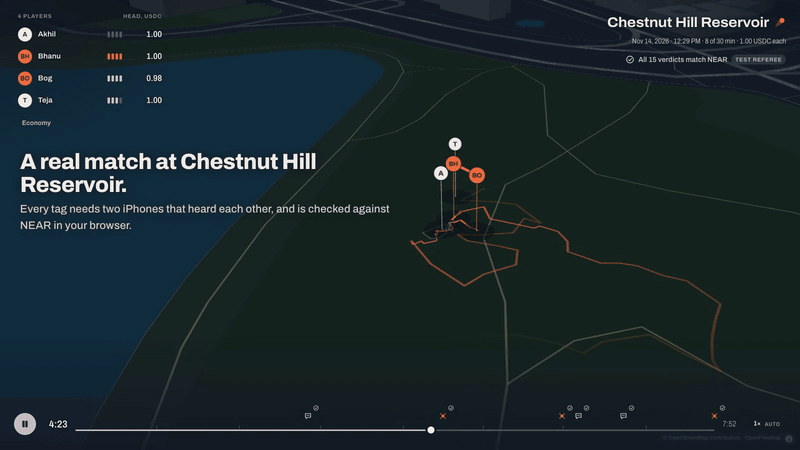
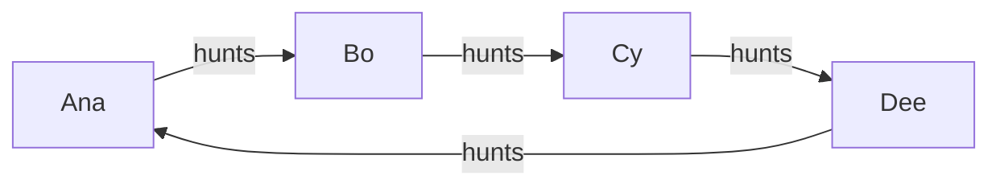
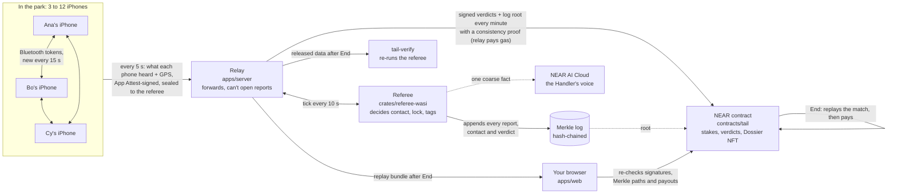

# TAIL

Real-world tag for 3 to 12 friends in a park, where every tag comes with proof.



**Live:** [playtail.app](https://playtail.app) · **Docs:** [playtail.app/docs](https://playtail.app/docs) ·
**How each proof works and where it stops:** [ARCHITECTURE.md](ARCHITECTURE.md) · Built for the NEAR
hackathon, on NEAR testnet.

## The problem

Location games trust the GPS a phone reports, and GPS is easy to fake, so spoofers win. In TAIL the
referee counts a tag only when two real iPhones heard each other over Bluetooth, judged from both
phones' sealed, signed reports, and a NEAR contract replays the whole match before any money moves.

## The game

Everyone stakes the same amount (test USDC) on their own head and gets one secret target; someone
else has them. Stay within Bluetooth range of your target until your **lock** fills, then
**strike**: their head and their target become yours. Your target sees **heat** rise but never
learns who. The Handler sells hints, priced by demand. You pay from your head into a pool that goes
to your target when they are tagged or the match ends, so whom you asked about stays off the
chain until End, which reveals it for the contract's replay. When time runs out, everyone still
standing keeps their head.

Targets form one secret ring, drawn by a VRF at Start. You see only the arrow out of you; when you
tag your target, their arrow becomes yours, and the last two hunt each other.



## Try it in a browser (nothing to install)

| Do                                                                                                                                                                                                                                                                                                                                                                                                                                                                                                                                                                                                                                                                                                                                                                                                                                                                                                                                                                                                                                                                                                                                               | See                                                                                                                                                                                                                                                                                                                                                            |
| ------------------------------------------------------------------------------------------------------------------------------------------------------------------------------------------------------------------------------------------------------------------------------------------------------------------------------------------------------------------------------------------------------------------------------------------------------------------------------------------------------------------------------------------------------------------------------------------------------------------------------------------------------------------------------------------------------------------------------------------------------------------------------------------------------------------------------------------------------------------------------------------------------------------------------------------------------------------------------------------------------------------------------------------------------------------------------------------------------------------------------------------------ | -------------------------------------------------------------------------------------------------------------------------------------------------------------------------------------------------------------------------------------------------------------------------------------------------------------------------------------------------------------- |
| Open [the real match at Chestnut Hill Reservoir](https://playtail.app/?match=c043db6be8eedceaf6194989e59b47e6)                                                                                                                                                                                                                                                                                                                                                                                                                                                                                                                                                                                                                                                                                                                                                                                                                                                                                                                                                                                                                                   | Four iPhones played it on 2026-11-14: three tags, three Handler hints, one survivor. Your browser re-checks every signature, Merkle root and payout against the contract and reads `All 15 verdicts match NEAR`. Click a Handler hint to see NEAR AI's TDX attestation of the key that signed its line.                                                        |
| Open [a presence proof from that match](https://playtail.app/?presence=eyJ0eXBlIjoidGFpbC9wcmVzZW5jZS1wcm9vZiIsIm1hdGNoSWQiOiJjMDQzZGI2YmU4ZWVkY2VhZjYxOTQ5ODllNTliNDdlNiIsImNvbnRyYWN0IjoidGFpbC50YWlsLWRldi1hMzhkMTMudGVzdG5ldCIsImNvbnRhY3QiOnsiYSI6MSwiYiI6MiwiZXBvY2giOjE3LCJzYWx0IjoiNTNjZDRjMmVmYmU4ZTBlZjk2YzljYmUwNDU4MWJjZmUifSwiaW5kZXgiOiIyNzUiLCJzaXplIjoiMzExIiwicGF0aCI6WyIwN2QzNjExNGY0MThkNTBkNzYzZmY5ZTkyODgwMmUyMzUxNTY5MGVjZWVlMTQ2ZmRlN2E1NTQyZGUyMzg0ZGQwIiwiNjI5OWNmNzJkYTY3Njc4OWE4NzE2N2Q5NmE3NDQxMTA4MzJmMzc3ZTJlYmQ0ZDZjMGYyMzBlZDJkYzA4ZGYxZCIsIjdiMjBkNzdlZDdkZWZhMjM3ZWJkOGExM2Q4YTgzNDdjMWMyNWVlMmM1NDA3ZWYxNTg0NzQ2NGUyMzEwN2MwZTAiLCJmOGRjMzUxN2UyMDY2MTI1ZGVlMzZmMGFjOWE2MTg2Yjk0MzA3MzkxM2UyZjNhM2JkOWY0MTQ4YjE3ZWY0OWE2IiwiMTA0ZGVmOGZjZGQ2ZDIzYTUxMTZhZjE4MjhlOTI1ODU1N2M1NzhhNDllNjc0MjJiMWNlNzMwYzdlYjFjMWEwMiIsIjNlZDZkMGMxYWY2MWY0MDI4YWZlMTJkZTYxMDM0M2RiMWU2ODhjZWIxM2M1NTM4NmFmZmNiY2VlNjBjNzgxYzQiLCI4MDk3Y2Y3NTU1YmE4ZmJlODFlNzVkZDFhODFhYjgyZmZmOTBiMDUwYjJiMTdlNWJhNGUxZmE2NDRmOWFjZDZlIl0sImFjY291bnRzIjpbImJoYW51LnRhaWwtZGV2LWEzOGQxMy50ZXN0bmV0IiwiYm9nLnRhaWwtZGV2LWEzOGQxMy50ZXN0bmV0Il19) | `The referee logged Bhanu and Bog near each other`, 12:33:31 to 12:33:46 PM, `Matches NEAR`: one logged contact, its 7-step Merkle path to the root the contract stored, and both players read from NEAR.                                                                                                                                                      |
| Open [playtail.app/?fixture=boston-common](https://playtail.app/?fixture=boston-common)                                                                                                                                                                                                                                                                                                                                                                                                                                                                                                                                                                                                                                                                                                                                                                                                                                                                                                                                                                                                                                                          | A generated 5-player match replays on a 3D map of Boston Common. The header counts `Checking … of …` while your browser re-checks every signature, root and payout, then `Comparing with NEAR`, then reads `Not on NEAR` (it is signed with public test keys and never sent to NEAR), in about 15 s. Pause, then click a tag on the timeline for its evidence. |
| Open [`?fixture=boston-common-tampered`](https://playtail.app/?fixture=boston-common-tampered)                                                                                                                                                                                                                                                                                                                                                                                                                                                                                                                                                                                                                                                                                                                                                                                                                                                                                                                                                                                                                                                   | One Tag verdict was rewritten after signing. The header reads `Verdict history is broken` and the tag is marked `Fails a check`.                                                                                                                                                                                                                               |
| Open [`?fixture=boston-common-tampered-log`](https://playtail.app/?fixture=boston-common-tampered-log)                                                                                                                                                                                                                                                                                                                                                                                                                                                                                                                                                                                                                                                                                                                                                                                                                                                                                                                                                                                                                                           | The referee rewrote a logged contact and re-signed everything after it. Every signature holds, but the Merkle consistency proofs fail: `The log was rewritten`.                                                                                                                                                                                                |
| Open [`?fixture=boston-common-economy&view=economy`](https://playtail.app/?fixture=boston-common-economy&view=economy), press `Whole match in 1 min`                                                                                                                                                                                                                                                                                                                                                                                                                                                                                                                                                                                                                                                                                                                                                                                                                                                                                                                                                                                             | A 12-player, 60-minute match played through the real rules engine: hint prices, the hint pool and every head move as hints are bought and tags land.                                                                                                                                                                                                           |
| Open [playtail.app/dossier/teja.tail-dev-a38d13.testnet](https://playtail.app/dossier/teja.tail-dev-a38d13.testnet)                                                                                                                                                                                                                                                                                                                                                                                                                                                                                                                                                                                                                                                                                                                                                                                                                                                                                                                                                                                                                              | A real player's soulbound Dossier NFT, read from the live contract's `nft_token`. The page draws the card itself and reports `Same picture as the contract's NFT, byte for byte.`                                                                                                                                                                              |

## How it works

A match is 3 to 12 phones. Every phone listens to every other, so any pair can turn out to be a
hunter and their target; the diagram shows three.



1. **Phones must hear each other.** Each phone broadcasts a 16-byte token that changes every 15
   seconds and that only the referee can tell apart, and logs the tokens it hears. A window counts
   as contact only when both phones heard each other above −82 dBm and their GPS fixes sit within
   40 m plus their accuracy. Four contact windows out of the last eight fill the lock.
2. **Real device, plausible movement.** Every report is signed with an Apple App Attest key and
   checked against Apple's root. Simulated locations and jumps faster than 15 m/s are refused;
   vehicle speeds freeze contact for two minutes.
3. **Sealed to the referee.** Reports are sealed (X25519, ChaCha20-Poly1305) to the referee's key,
   which each phone checks against the key pinned on NEAR. The relay forwards them and cannot open
   them.
4. **One Merkle log for the whole match.** The referee appends every accepted report, refusal,
   contact and verdict to a hash-chained Merkle tree, and signs each verdict. Every minute the
   tree's root goes on NEAR with a consistency proof that the new tree extends the old one, so
   rewriting anything already logged is caught. Each phone checks its own reports are in the
   tree, a tag's evidence is a set of logged contacts with their Merkle paths, and a presence
   proof is one such path. Targets come from a VRF committed on NEAR at Start and revealed at End.
5. **NEAR checks before it pays.** The contract applies only referee-signed verdicts, in order. At
   End it rebuilds the ring of targets and replays every hint price, tag and forfeit. One broken
   rule refunds every stake; so does a referee that goes silent for 15 minutes.
6. **Anyone can check it again.** The browser replay re-checks signatures, Merkle roots and paths,
   the draw and the payouts against NEAR. `tail-verify` re-runs the referee on the released data
   and must get every verdict back byte for byte.

## What's built

- **A hint market priced by demand.** Each hint costs 25 % more per hint bought in the last 5
  minutes, up to 4×. The rule is one readable file per language
  (`crates/tail-protocol/src/pricing.rs`, `packages/protocol/src/pricing.ts`), and the contract
  recomputes every price and refuses any other amount. The economy view replays it fast-forwarded.
- **No seed phrase, no signing popups.** The phone makes its own key; the relay creates
  `<handle>.tail-dev-a38d13.testnet` holding only a key that can join, leave and withdraw, and pays
  the gas. The one chain step a player sees is naming a wallet on their first withdraw.
- **Private by default.** HUDs and Handler lines are sealed to each phone and padded to one length,
  so the relay software can't tell positions, who was near whom, or whom a hint was about. A
  private replay opens only for a player who signs the relay's challenge, and the relay deletes a
  private match's trails 24 hours after End (`apps/server/src/retention.ts`).
- **An attested AI Handler.** The Handler's lines come from an open-weight model on NEAR AI Cloud.
  The replay's "Verified" panel and `scripts/verify-nearai.ts` check NEAR AI's Intel TDX
  attestation of the key that signs them, with a fresh nonce. That shows a genuine TDX machine
  holds the key, not which code the machine runs.
- **A soulbound Dossier NFT.** NEP-171 with NEP-177 metadata and NEP-181 enumeration, one per
  player, token id = the player's account. The contract writes each settled match into it and
  draws its SVG on every read. It can't be transferred because it's a credential: a host can open
  a match only to players with a record (`requires: {min_matches, min_survived}`), set in the app.
- **Presence proofs.** A logged contact between two players with its Merkle path to a root on NEAR,
  checkable by anyone with the contract's `verify_inclusion` view (`/?presence=`). The proximity
  layer that produces them (`apps/mobile/src/proximity/`) imports nothing from the game.

## Beyond the game

- **Proof that people met.** The evidence behind a tag, two App Attest-verified phones in mutual
  radio contact, logged and anchored on NEAR, answers questions outside games: did a volunteer
  shift, a meetup or a city walking program actually bring people together. A presence proof is
  checked by anyone against the contract, with no account and no trust in our servers.
- **Who pays.** The house takes nothing: stakes only move between players' heads. The relay pays
  gas, measured at 2.3 to 4.2 Tgas per verdict on testnet. A match can also be free to join and
  funded by a sponsor: `create_match` names up to four sponsors and allows a stake of 0, and at End
  the sponsor pot is split equally among the survivors (`contracts/tail/src/lib.rs`). The contract
  supports this today; the app has no flow for it yet.
- **Next.** Run the referee in the enclave once OutLayer's testnet runs calls again, play outdoor
  matches in parks, and add sponsored matches to the app.

## Run it from source

Needs [Bun](https://bun.sh) 1.4+ and Rust via rustup (toolchains are pinned in
`rust-toolchain.toml` and `crates/referee-wasi/rust-toolchain.toml`).

| Do                                                                                                                                                                                                                                                                                                        | See                                                                                                                                                                                                                                                                                                             |
| --------------------------------------------------------------------------------------------------------------------------------------------------------------------------------------------------------------------------------------------------------------------------------------------------------- | --------------------------------------------------------------------------------------------------------------------------------------------------------------------------------------------------------------------------------------------------------------------------------------------------------------- |
| `bun install && bun run check ts rust contract referee`                                                                                                                                                                                                                                                   | `all 12 steps passed`: Biome, TypeScript, Bun tests, Rust fmt/clippy/tests (golden vectors shared by TS and Rust, 28 scripted matches, Merkle proofs), the contract's tests and the referee module's lint. `bun run check` adds Swift lint and a secret scan (needs Xcode and gitleaks): `all 14 steps passed`. |
| `cargo run -q -p referee-verify --example demo-bundle > /tmp/match.json && cargo run -q -p referee-verify -- /tmp/match.json`                                                                                                                                                                             | `PASS`, exit 0: the match re-ran through the rules engine with every log entry and verdict identical, App Attest assertions and contacts recomputed. For a real match, pin the keys from the contract's `get_match` with `--referee-pk` and `--vrf-pk` (`crates/referee-verify/README.md`).                     |
| `cargo run -q -p referee-verify --example demo-bundle -- --forge-tag > /tmp/forged.json && cargo run -q -p referee-verify -- /tmp/forged.json`                                                                                                                                                            | A tag rewritten but still carrying a valid referee signature: `FAIL tick 13: verdict seq 5: …`, exit 1.                                                                                                                                                                                                         |
| `curl -s https://playtail.app/matches/c043db6be8eedceaf6194989e59b47e6.json > /tmp/real.json && cargo run -q -p referee-verify -- /tmp/real.json --referee-pk d35338a9a4636d104deca3291c588cd9a7369c0b957b284b68be8ce64d286594 --vrf-pk ad82f28f06474c7cfcf3ba721c959863436a3f55a5ccb800ed2eefc83b4defcb` | `PASS` on the real match, with the keys the contract pins (`get_match`): 15 verdict signatures, 431 log entries and 15 verdicts re-executed identically, 308 phone reports re-checked against App Attest.                                                                                                       |
| `bun run --cwd apps/web dev`, open http://localhost:5173                                                                                                                                                                                                                                                  | The site and replay above, served locally.                                                                                                                                                                                                                                                                      |

### Play on NEAR testnet with simulated phones

This needs your own contract on testnet: our contract accepts only verdicts from the referee whose
keys it pins. Copy `.env.example` to `.env.local`, fill in a funded relay account and the contract
you deployed (`TAIL_CONTRACT`, deployed with `contracts/tail/e2e/deploy.ts`), then build the local test referee and
pin its keys on that contract (`apps/server/README.md`, "The local test referee"):

```sh
cargo build --release --manifest-path crates/referee-wasi/Cargo.toml --bin tail-referee
REFEREE_MODE=local bun apps/server/scripts/pin-referee.ts
REFEREE_MODE=local ALLOW_GHOSTS=1 bun apps/server/scripts/ghost-match.ts
```

Three simulated phones enrol, join and play a 5-minute match through the relay, the local test
referee and your contract: a hint, then a tag when the lock fills. The script checks the contract
after each step, and the log with a Merkle inclusion and consistency proof at the end. A run costs
about 0.5 testnet NEAR.

### Play on iPhones

1. Build and install the app from source with Xcode on each phone (Developer Mode on):
   `apps/mobile/README.md`, "Build onto a phone". Your Apple team needs the App Attest capability.
2. Point it at a relay. Set `TAIL_RELAY_URL` in `.env.local` before building, or type it in the
   app under **Settings → Advanced**. Run your own relay with `bun run --cwd apps/server start`
   (settings: `apps/server/README.md`).
3. Our relay is `https://relay.playtail.app`. The referee accepts only App Attest keys for our App
   ID (`APP_ID` in `crates/referee-wasi/src/cmd/mod.rs`), so a build signed by another Apple team
   plays only against its own relay and referee, with that constant changed.
4. A match needs three players. The host creates it, the others join with its code; turn on
   **Public replay** to let anyone open the replay afterwards.

## Status

| Works    | Detail                                                                                                                                                                                                                                                                                                                                                                |
| -------- | --------------------------------------------------------------------------------------------------------------------------------------------------------------------------------------------------------------------------------------------------------------------------------------------------------------------------------------------------------------------- |
| Contract | `tail.tail-dev-a38d13.testnet`: verdict chain, consistency-checked checkpoints, demand-priced hints, End replay and payout, Dossier NFT                                                                                                                                                                                                                               |
| iPhones  | On 2026-11-14 four iPhones with App Attest played a match outdoors at Chestnut Hill Reservoir: three tags from real mutual Bluetooth contact, three Handler hints (two voiced by NEAR AI's model, one template line after a timeout), End paid the survivor after the contract's replay, and `tail-verify` re-runs it identically. Two people carried the four phones |
| Site     | [playtail.app](https://playtail.app): front page, docs, replay and verifier, dossier page against the live contract                                                                                                                                                                                                                                                   |
| Relay    | Runs on our Mac behind a Cloudflare tunnel at `relay.playtail.app`; `/relay/*` on the site reaches it                                                                                                                                                                                                                                                                 |

| Not yet     | Detail                                                                                                                                                                                                                                                                                                                                                                              |
| ----------- | ----------------------------------------------------------------------------------------------------------------------------------------------------------------------------------------------------------------------------------------------------------------------------------------------------------------------------------------------------------------------------------- |
| The enclave | The live contract pins a **local test referee**: the same referee code on our machine, so trusting the referee means trusting us, and the replay labels it `Test referee`. The OutLayer build of this source is deployed but has never completed a call: OutLayer's testnet holds each call 80 to 90 s, too slow for 10-second ticks. The replay does not pin that build's hash yet |
| Range       | Bluetooth range and pocket-mode tests on their own                                                                                                                                                                                                                                                                                                                                  |
| On a phone  | The signed private-replay link has run only in tests                                                                                                                                                                                                                                                                                                                                |
| Mesh carry  | The Offline Protocol SDK carries reports phone to phone, but its advertisement crowds out TAIL's beacon, so it is off by default                                                                                                                                                                                                                                                    |
| Review      | The first contract version was security-reviewed and fixed; this round's contract changes have had no outside review                                                                                                                                                                                                                                                                |

## What this does not claim

- **GPS isn't proven.** Apple doesn't attest the GPS chip. The claim is our app on a real iPhone,
  mutual radio contact and physically plausible movement.
- **The referee is trusted.** Today it is a test referee on our machine (Status, above), so
  trusting it means trusting us. Proximity is judged by the referee and checked again off-chain:
  the replay checks each tag's logged contacts against the lock rule, and `tail-verify` recomputes
  contact from the raw reports after End. The contract checks the ring, hint prices and money, not
  the radio evidence, which stays sealed.
- **No distance bounding.** Someone relaying Bluetooth between two phones in real time, plus
  location spoofing on an attested phone, could fake proximity.
- **Foreground only.** The app must stay open; pocket mode turns the screen off.

Every claim, the code that enforces it and where it stops: [ARCHITECTURE.md](ARCHITECTURE.md).

## Repository

```
packages/protocol      wire formats, crypto, pricing, Merkle and presence proofs (TypeScript)
crates/tail-protocol   the same in Rust, pinned to the same bytes by golden vectors
crates/referee-core    the rules engine: pure and deterministic
crates/referee-sim     scripted matches through the engine
crates/referee-verify  tail-verify: re-runs a finished match
crates/referee-wasi    the referee: OutLayer module, or the local test referee built natively
crates/appattest       App Attest checks (Rust, in the referee)
contracts/tail         the NEAR contract and the Dossier NFT
apps/server            the relay: Bun, Hono, SQLite
apps/web               site, docs, replay and verifier: React, MapLibre, deck.gl
apps/mobile            the iPhone app: Expo, React Native, Swift Bluetooth module
packages/appattest     App Attest checks (TypeScript, the relay's own)
packages/brand         logo, colours, icons, the Dossier card
packages/log           logging with secret redaction
scripts/verify-nearai.ts   checks NEAR AI's attestation of the Handler's signing key
```

## Dependencies

The Offline Protocol mesh SDK (`@offline-protocol/mesh-sdk`, AGPL-3.0) for mesh carry; map data
© OpenStreetMap contributors, tiles by OpenFreeMap; the Archivo typeface (SIL OFL).

## License

AGPL-3.0-only. See `LICENSE`.
